# AI system with ML, GenAI, and Agentic workflow

This project introduces a **LangGraph-driven agentic system** that automatically detect credit card fraud transaction. First it uses a trained ML(Machine-Learning) classier with optimized dual thresholds, then escalate the remaining to an LLM-Agent that uses a historical context saved in Chroma Vector database as Long-Term Memory(LTM). If LLM-Agent is uncertain, it  will escalate to Human. CTGAN (Conditional Tabular GAN)  generative model is trained and used to generate extra new transaction samples for test and benchmarking the agentic workflow.


- __[PDF Report](./report/report.pdf)__
- __[Presentation Slides](./report/presentation.pdf)__

## System Diagram
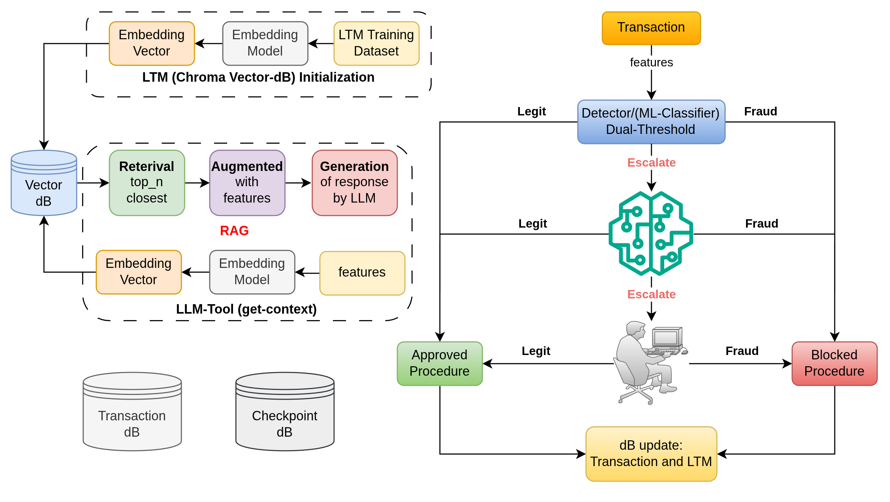

## How to run the project
## Dataset
- Name: Credit Card Fraud Detection
- Source: https://www.kaggle.com/datasets/mlg-ulb/creditcardfraud
- Download Info: dataset should be saved in [data folder](./data), with the name `creditcard.csv` if downloaded manually, otherwise the provided code for downloading is using `KAGGLE_API_TOKEN` environment variable that can be set as explained in [sample.env](./sample.env). Since dataset is large (150MB) it's not added to github.


### Quick-Setup (before Running)
```console
#clone or unzip the project, cd to the project
max@m223:~/x/tmp/zc07-ml-genai-agentic$ uv init --python 3.13
max@m223:~/x/tmp/zc07-ml-genai-agentic$ uv add -r requirements.txt
max@m223:~/x/tmp/zc07-ml-genai-agentic$ uv pip install -e .
#copy sample.env as .env and update OPENAI_API_KEY, (and OPENAI_BASE_URL if required)
#if you have KAGGLE_API_TOKEN, also add it to .env for dataset automatic download
#Otherwise download manually as explained above
```
### Detail-Setup (before Running)
- GitHub Link: https://github.com/umscai/zc07-ml-genai-agentic
- The project __tested__ with Python version `3.13.14`, and __recommended__ to use python version `3.13 or above`
- We used uv for easier and faster package management and virtual environment setting.
- The sample timing is based on: Intel Core i5-8400 CPU @ 2.80GHz, and  NVIDIA GeForce GTX 1660 (6GB)

1. __Clone__ the repo using the above link (if you have access), or unzip the provided compressed file.
2. __Install__ dependencies using `uv add -r requirements.txt`
4. __IMPORTANT-1__: run  `uv pip install -e .`, to avoid path resolution especially for `.env` file
5. __IMPORTANT-2__: This project depends on the parameters in .env located on the project root folder
    - See instruction and required parameters in sample `.env` file: [sample.env](./sample.env), Updating `OPENAI_API_KEY` is __mandatory__, OPENAI_BASE_UR if required, and other parameters are already set with intended values.
6. __IMPORTANT-3__: If you have `KAGGLE_API_TOKEN`, add it to .env for handling automatic download of the required dataset, otherwise download it manually as explained above in [Dataset-section](#dataset)
7. __NOTE__: the results of some time-consuming training (hours) are saved, and when they are exist, they will be loaded, but still we have to run all steps, one by one before running the agentic-system

### Running (after setup)
Run jupyter lab, and go to notebook folder
1. run `step1_ml_clf_with_oversampling.ipynb` (about 3-min)
2. run `step2_genai.ipynb` (about 8-min)
3. run `step3_prepare_data_for_ltm.ipynb` (about 3-min)
4. run `step4_agentic_test_results.ipynb` (about 1-min), Just to become more familiar with agentic_system.py (or check html version of step4 in report folder)
6. __Run__: `uv run agentic_system.py --source real --node det --label tn --test 1`
7. __Expected Results__: (note, when it's the first run, all required folder and databases will be created)

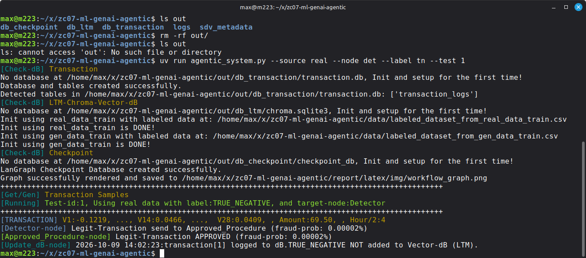


8. __Script Help__: `uv run agentic_system.py -h` or `uv run agentic_system.py --help`

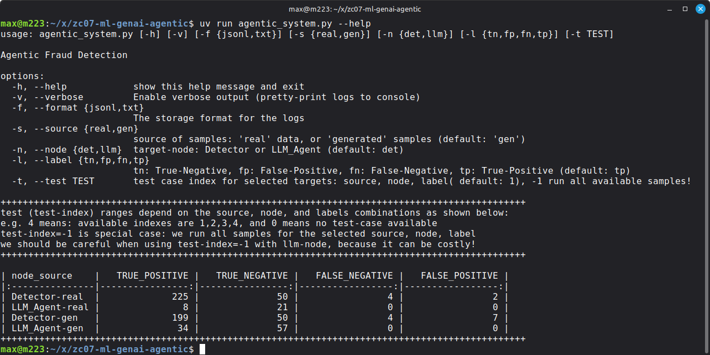


## Folder and File Structure
Project folder and file structures are shown below, where `agentic_system.py` is main script, and all supporting functions collected `src`, and `out` folder will be generated (In first run for databases, and logs) while `data` folder is devoted for dataset and other files like trained models, and `report` folder contains report related files, while pdf report will be in details, the html versions of all notebook also added here.

`run_all_test.sh` is used to run all test, separated with node (det and llm) as command line arguments

```console.
.
├── agentic_system.py
├── data
│   ├── all_test_case_runx2_trans_db.csv
|   ├── creditcard.csv ........................ NEED to be downloaded manually, if no `KAGGLE_API_TOKEN` provided in .env file
│   ├── amount_mean_std.pkl
│   ├── dual_thresholds.pkl
│   ├── labeled_dataset_from_gen_data.csv
│   ├── labeled_dataset_from_gen_data_info.pkl
│   ├── labeled_dataset_from_real_data.csv
│   ├── labeled_dataset_from_real_data_info.pkl
│   ├── ml_models
│   ├── run_all_test_log2_cleaned.txt
│   └── run_all_test_log_cleaned.txt
├── LICENSE
├── minimal_req.ini
├── notebook
│   ├── step1_ml_clf_with_oversampling.ipynb
│   ├── step2_genai.ipynb
│   ├── step3_prepare_data_for_ltm.ipynb
│   └── step4_agentic_test_results.ipynb
├── README.md
├── report
│   ├── latex
│   ├── presentation.pdf
│   ├── report.pdf
│   ├── step1_ml_clf_with_oversampling.html
│   ├── step2_genai.html
│   ├── step3_prepare_data_for_ltm.html
│   └── step4_agentic_test_results.html
├── requirements.txt
├── run_all_test.sh
├── sample.env
└── src
    ├── agents
    ├── config.py
    ├── db_model
    ├── orchestration
    ├── tools
    ├── utils_gen.py
    ├── utils.py
    └── utils_test.py

```


## In step-1
- Used Hour/2 instead of time (feature engineering)
- Trained and compared XGBoost classifier without oversampling using cost-sensitive learning, and with oversampling (using SMOTE/BorderLine SMOTE, Generative Modes: TVAE, CTGAN). Model with CTGAN and no oversampling were promising
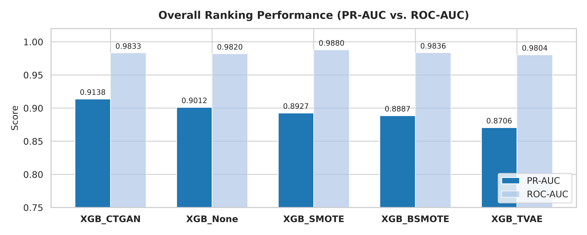
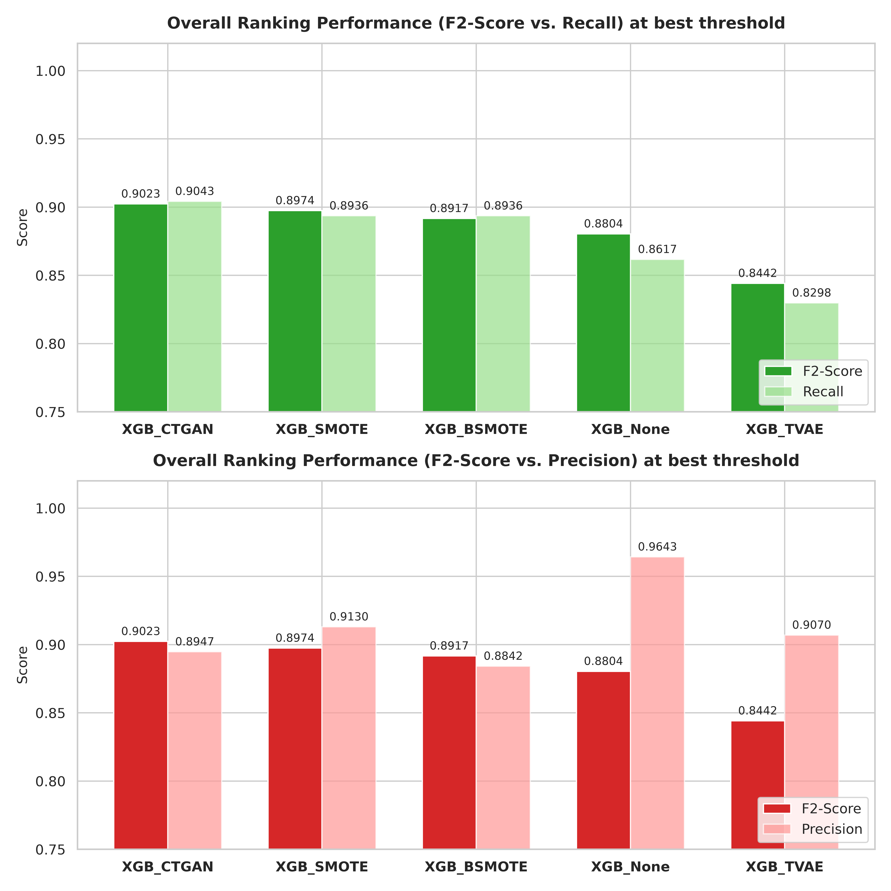
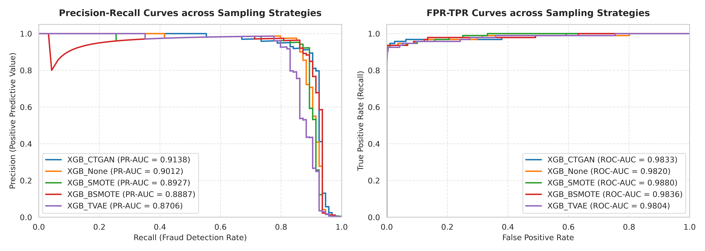

## In Step-2
- We Trained generative models TVAE and CTGAN on full dataset
- Compare them with different visual and numerical methods, and select CTGAN model with ML-classifier oversampled with CTGAN


## In Step-3
- We use both real-dataset and generated-dataset, and find optimal dual thresholds  by defining a proper cost function
- We define a dataset for agentic-workflow evaluation, and split it into train and test dataset
- We define a Vector-dB with proper embedding vectors (extracted from transaction data)
###  Sample Single Threshold Optimization
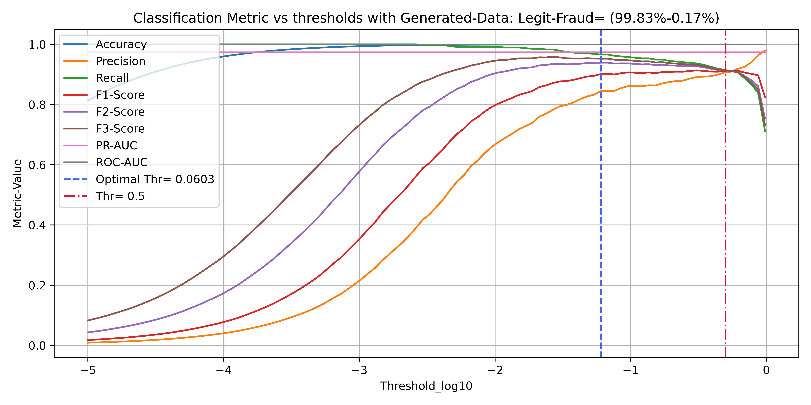

###  Sample Dual Thresholds Optimization
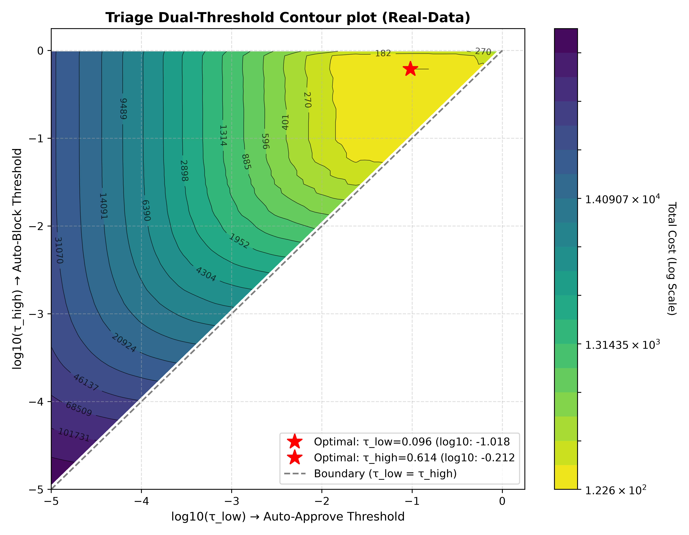

### Effect of Dual Threshold
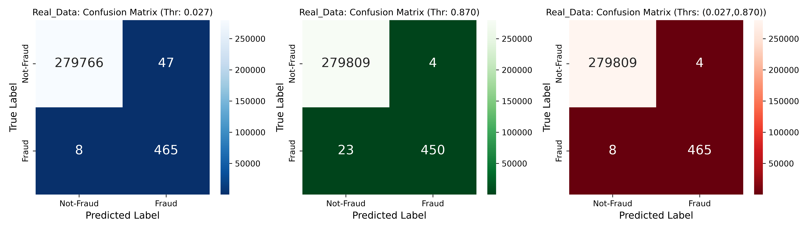

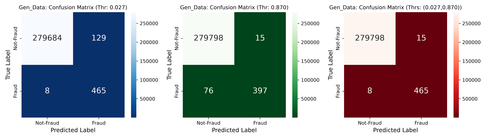

## In Step-4
- We use the train-dataset to initialize a vector database as Long-Term Memory
- We use the test-dataset to evaluate our agentic workflow

### Workflow Graph
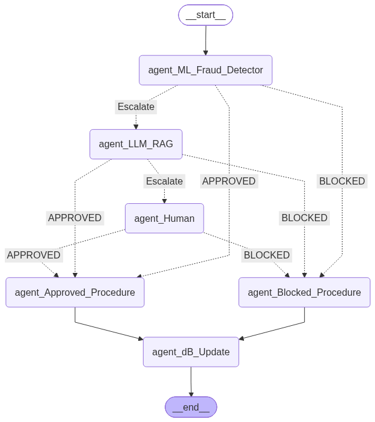

### Sample run handled by Detector
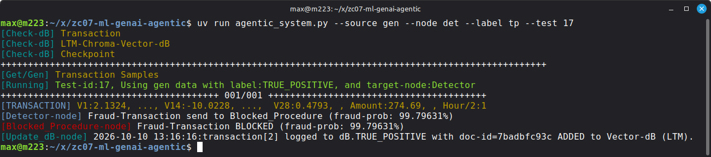
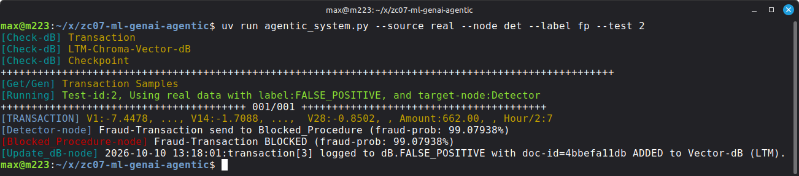

### Sample run escalated to LLM-Agent
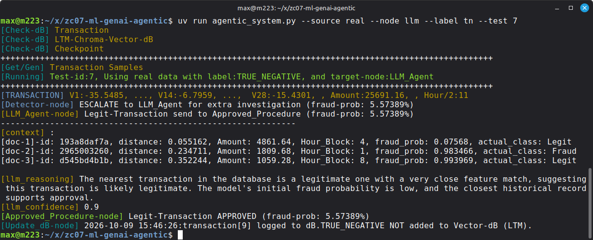

### Sample run escalated to Human
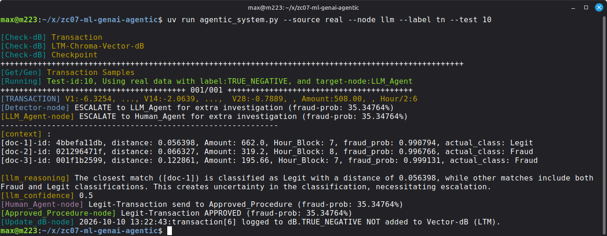

### Sample run with LLM-Agent mistake
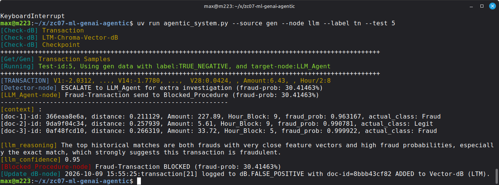
#### Running again, LTM will fix the issue
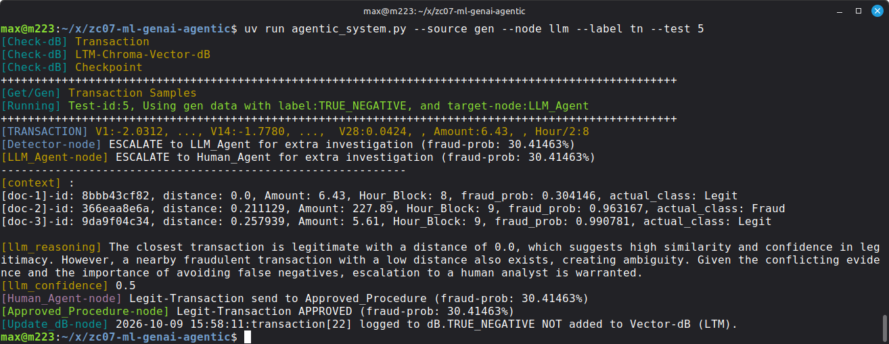


## Overall results of 661 test-cases

### Test-Case Count Info

| node_source    |   TRUE_POSITIVE |   TRUE_NEGATIVE |   FALSE_NEGATIVE |   FALSE_POSITIVE |   Test_Case_Count |
|:---------------|----------------:|----------------:|-----------------:|-----------------:|------------------:|
| Detector-real  |             225 |              50 |                4 |                2 |               281 |
| LLM_Agent-real |               8 |              21 |                0 |                0 |                29 |
| Detector-gen   |             199 |              50 |                4 |                7 |               260 |
| LLM_Agent-gen  |              34 |              57 |                0 |                0 |                91 |
| Column_Sum     |             466 |             178 |                8 |                9 |               661 |

We can run all test case like below
```console
max@m223:~/x/zc07-ml-genai-agentic$ ./run_all_test.sh det
Script finished in 8m 17s (Total: 497 seconds).
max@m223:~/x/zc07-ml-genai-agentic$ ./run_all_test.sh llm
Script finished in 15m 11s (Total: 911 seconds).
```

First we delete the `out` folder (no database), then run all test-cases where we used training-dataset to initialize LTM, then without deleting out-folder (kept all database, including LTM that now should have info on test-dataset), we run it again just to see the effect of ideal LTM


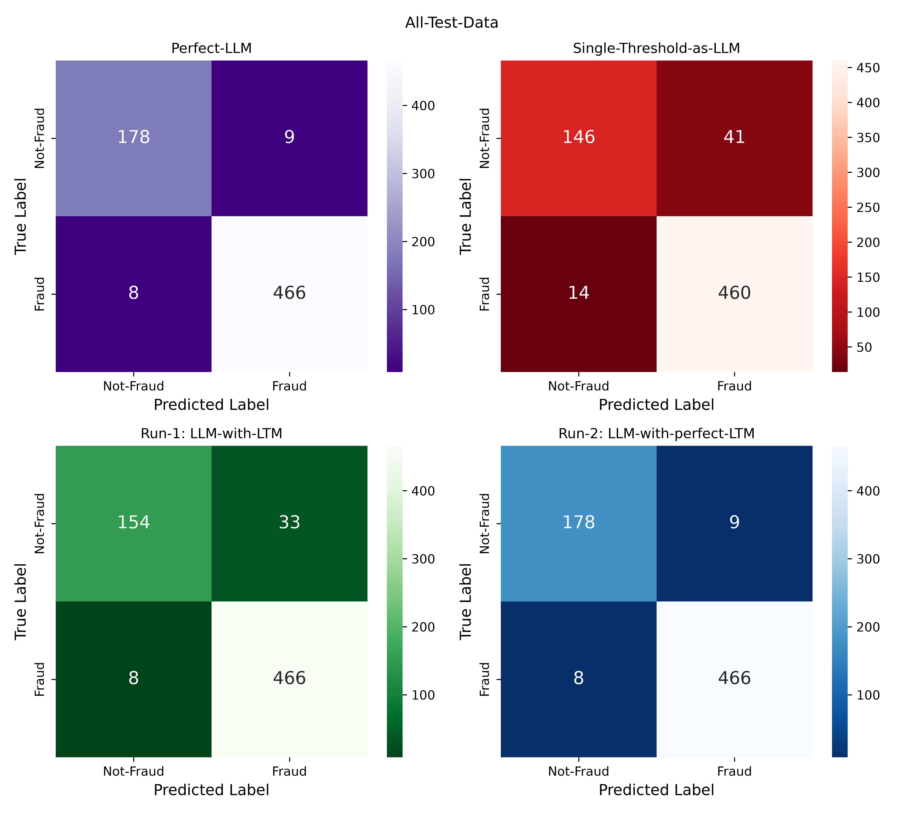

numerical value

| Run                         |   Accuracy |   Precision |   Recall |   F1-Score |   F2-Score |
|:----------------------------|-----------:|------------:|---------:|-----------:|-----------:|
| Perfect-LLM                 |      97.43 |       98.11 |    98.31 |      98.21 |      98.27 |
| Single-Threshold-as-LLM     |      91.68 |       91.82 |    97.05 |      94.36 |      95.95 |
| __Run-1: LLM-with-LTM__         |      93.8  |       93.39 |    98.31 |      95.79 |      __97.29__ |
| Run-2: LLM-with-perfect-LTM |      97.43 |       98.11 |    98.31 |      98.21 |      98.27 |


- Using agentic workflow have better performance
- Also using agentic workflow is more reliable that having a single-threshold that may need keep re-tuning
- System performance (called __Run-1__: when we load train-dataset to LTM, and test based on test-dataset) is about __F2-Score = `97.3%`__
- Detailed discussion on possible __metric inflation__ (inevitable in this feasible study), and solution in production, is given in [pdf-report](./report/report.pdf), and the realistic performance with `5%` inflation assumption can be `92.3%`.


## Analytics
- After first detector stage using ML-classifier with dual thresholds, only `18.2%` need Escalation to LLM-Agent
- LLM-Agent can handle `83%` of its task, and only need to Escalate `17%` of its task to Human (`3.1%` of total task handle by system)

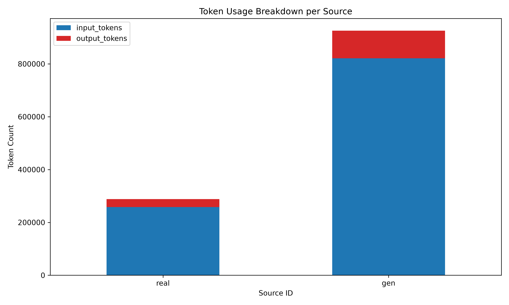

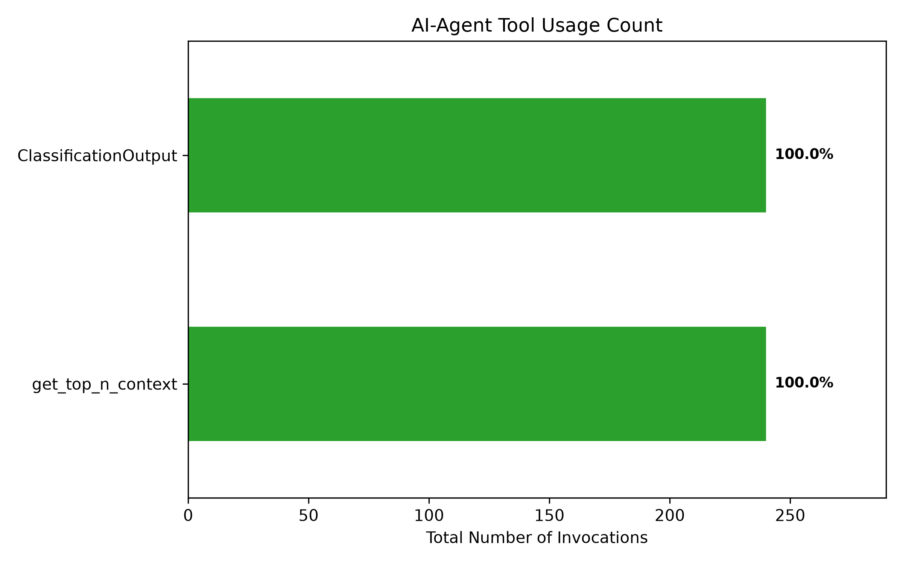

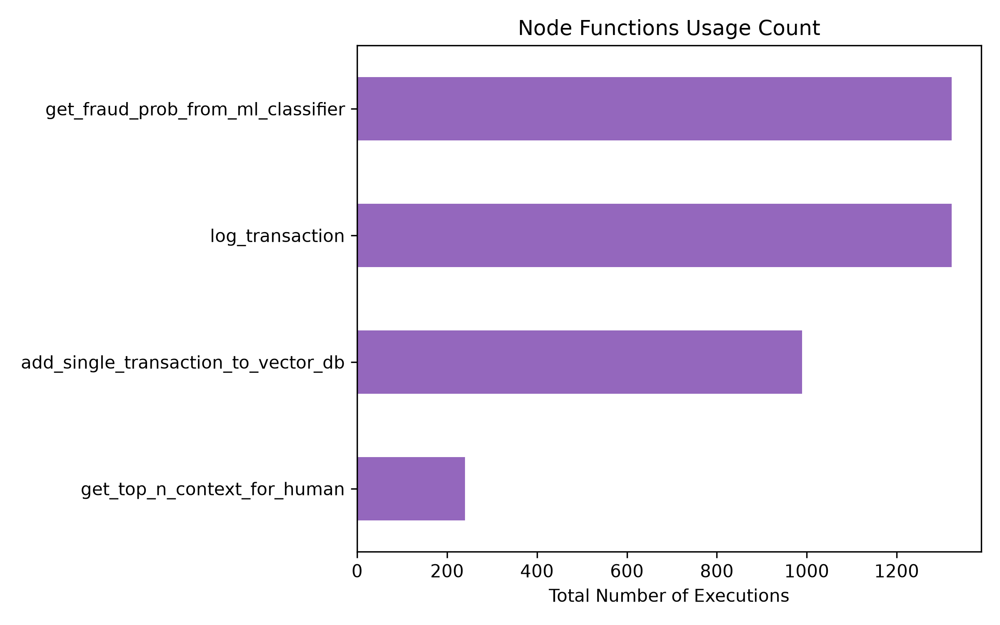

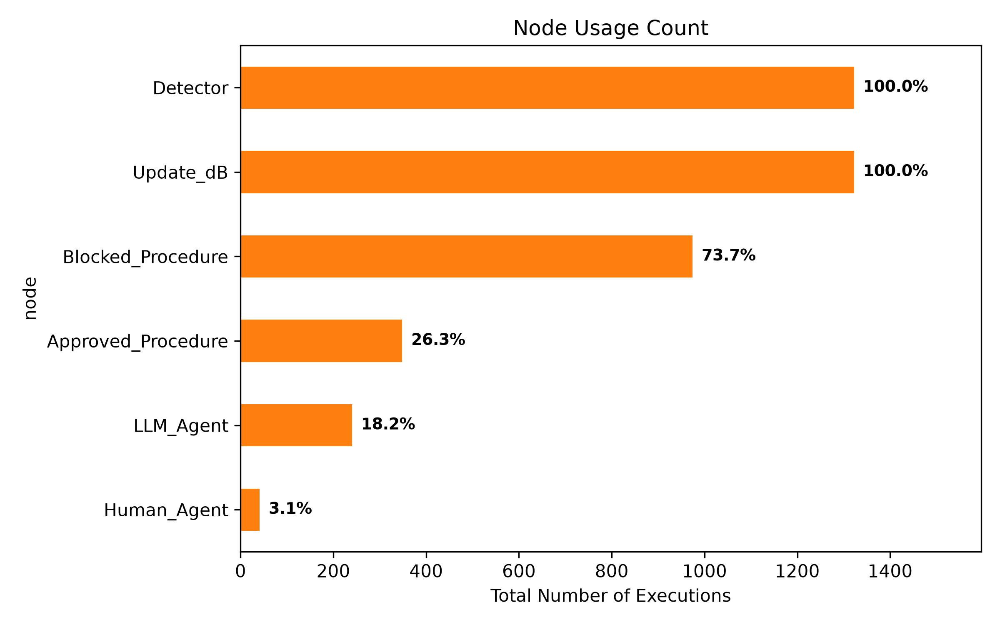


| node               |   usage_count |   usage_count% |
|:-------------------|--------------:|---------------:|
| Human_Agent        |            41 |          3.101 |
| LLM_Agent          |           240 |         18.154 |
| Approved_Procedure |           348 |         26.324 |
| Blocked_Procedure  |           974 |         73.676 |
| Update_dB          |          1322 |        100     |
| Detector           |          1322 |        100     |

## Future work:
- When we optimize the dual thresholds for simplicity we use  one parameter as agent-accuracy
- we use this accuracy as both recall and precision
- based on the limited number of test here we find the LLM-agent metric values (accuracy, recall, precision, f1 and f2 scores)
- Obviously based on our prompt which put more importance on FN, we end up having high recall `100%` and low precision `63.64%` for LLM-Agent
- This will create good __F2-Score__ as the target metric (LLM-Agent: F2-Score = `89.74%`)
- This results suggest that we have to modify our dual-threshold optimization to consider different recall/precision for agent
- Also we need to collect more data for better estimation of these recall/precision then re-optimized our dual-thresholds

